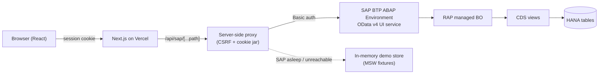

# ProcureFlow

A production-style procurement approval workflow. Employees raise purchase
requisitions; managers approve or reject them; approved requisitions convert
into purchase orders — backed by a SAP RAP business object on SAP BTP ABAP
Environment, with a Next.js frontend.


**Live demo:** [procureflow-alpha.vercel.app](https://procureflow-alpha.vercel.app) —
click **Try as Requestor** or **Try as Approver** on the login page, no
sign-up needed. The SAP backend runs on a BTP *trial* system that hibernates
nightly; when it's asleep the app switches to demo data automatically and
says so in a banner (see [Demo fallback](#demo-fallback-when-the-sap-trial-is-asleep)).

## Demo video

_A short walkthrough (login → create → submit → approve → purchase order) will
be linked here._

<!-- Replace this section with, e.g.:
[](https://www.youtube.com/watch?v=VIDEO_ID)
-->

## Architecture



Key decisions:
- **Proxy pattern**: the browser never talks to SAP directly. `/api/sap/[...path]` centralizes CSRF token handling, cookie replay, and error normalization.
- **RAP managed** implementation, `strict(2)`: framework-generated CRUD + four custom actions (`SubmitForApproval`, `Approve`, `Reject`, `CreatePurchaseOrder`).
- **Demo fallback**: if SAP can't be reached, the same proxy answers from an in-memory store instead of showing an error (details below).
- Two demo users (`requestor@demo` / `approver@demo`), one shared SAP technical communication user.

## Demo fallback (when the SAP trial is asleep)

BTP trial systems hibernate nightly and can be deleted, so a visitor may
arrive when there is no live backend. Rather than show an error, the proxy
falls back to demo data:

- **Triggers**: network failure, no response within `SAP_TIMEOUT_MS` (default
  6000 ms), a gateway 502/503/504, a non-OData error body from the platform, or
  SAP not being configured. A *business* error from a healthy SAP (e.g. a
  validation failure) is passed through as normal — it does not trigger the fallback.
- **Scope**: per session. The proxy sets a `pf_demo` cookie (15 minutes), after
  which that session skips SAP entirely and is served from the demo store. The
  UI shows *"SAP backend asleep (trial system) — showing demo data."* with a
  **Retry live backend** button; once the cookie expires, SAP is tried again.
- **Demo data is in memory**, in the same fixture store used by the tests
  (`web/src/mocks/`). It resets when the server instance restarts, so changes
  made in demo mode are not durable.

## Repo layout

```
abap/       ABAP source (authored here, activated manually in Eclipse ADT)
web/        Next.js 16 App Router, TypeScript strict, Tailwind v4
docs/       Phase verification records, redeploy runbook, demo script
```

## Local setup (mock mode — no SAP needed)

```bash
cd web
pnpm install
cp .env.example .env.local
echo "MOCK_SAP=1" >> .env.local
echo "NEXTAUTH_SECRET=$(openssl rand -base64 32)" >> .env.local
pnpm dev
```

Open `http://localhost:3000/login` and click **Try as Requestor** / **Try as
Approver** (or sign in with `requestor@demo` / `approver@demo`, password
`demo1234`). In mock mode, all SAP calls are served by an in-memory fixture
store (`web/src/mocks/`) via MSW — no live BTP connection required.

## Tests

```bash
cd web
pnpm lint            # eslint
pnpm typecheck       # tsc --noEmit
pnpm test            # vitest (unit + integration, MSW-mocked)
pnpm e2e             # playwright, mock mode (includes an axe-core accessibility sweep)
node scripts/sap-smoke.mjs   # live API smoke test — needs a running BTP system + .env.local
```

## Live SAP backend

The ABAP source lives in [`abap/`](abap/) and is activated by hand in Eclipse
ADT — it is not abapGit-linked: the files here are plain source, not abapGit's
serialized format (`.abapgit.xml` plus per-object XML), which is best exported
from the activated package rather than written by hand.
- [`abap/MANIFEST.md`](abap/MANIFEST.md) — object creation order.
- [`docs/REDEPLOY.md`](docs/REDEPLOY.md) — full runbook to recreate the
  backend after a BTP trial reset (trial systems can be deleted).
- BTP trial systems hibernate nightly — start the system in the BTP cockpit
  before a live demo.

## Demo

See [`docs/DEMO.md`](docs/DEMO.md) for a 3-minute walkthrough script.
